# Arena LLM

Banco de pruebas **independiente del hardware** para modelos de IA locales (llama.cpp). Es una web local que **mide, enfrenta y compara modelos** en cualquier equipo y tarjeta, con la telemetría del equipo (cada GPU, CPU y RAM) siempre a la vista.

Resuelve un problema concreto: comparar dos modelos, dos cuantizaciones o dos tarjetas suele acabar en cifras sueltas que no se pueden comparar. Arena detecta cada `llama-server` y su configuración, lo prueba con el mismo perfil en cualquier equipo, guarda la foto de configuración con cada run y dice si dos resultados son **comparables** y por qué.

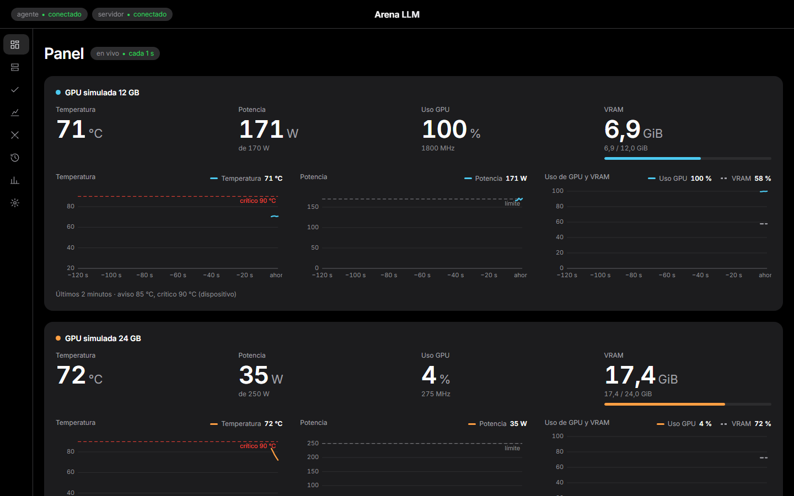

> **Sobre las imágenes.** Las capturas y animaciones de Panel, Calidad, Rendimiento, Historial y Ajustes están hechas con el **modo simulado** (perfil `nvidia2`, `llama-server` simulados y GGUF falsos; las GPU se llaman "GPU simulada 12 GB"). Las de **Servidores, Batalla (nota, podio, paquetes y ranking) y Comparar con nota** (formato `.jpg`) son de un equipo real (Tesla M40 24 GB + RTX 3060 + Ryzen 5 3600, con Qwen2.5-Coder-14B Q4_K_M). En ellas el nombre del equipo se ha sustituido por «MI-PC» y las rutas de modelos se han acortado; no hay claves ni tokens.

## Índice

- [Funciones](#funciones): Panel, Servidores (detectar, lanzar y parar), Calidad, Rendimiento, Batalla (paquetes, nota 0-100, podio y ranking), Historial, Comparar, Ajustes y exportación.
- [Novedades recientes de la interfaz](#novedades-recientes-de-la-interfaz)
- Guías: [uso](docs/USO.md) y [cómo ampliar Arena](docs/EXTENDER.md)
- [Instalación y arranque](#instalación-y-arranque)
- [Principios](#principios), [componentes](#componentes), [estado por fases](#estado-por-fases) y [documentación](#documentación)

## Funciones

El menú lateral tiene nueve secciones: Panel, Servidores, Asistente, Calidad, Rendimiento, Batalla, Historial, Comparar y Ajustes. Guía por flujos en [`docs/USO.md`](docs/USO.md). La franja del equipo (una tarjeta por GPU, CPU y RAM) está arriba en todas las pantallas y se puede plegar con **Plegar**.

### Panel y telemetría en vivo

Temperatura, potencia, uso, VRAM, relojes, ventilador, estado P y throttling de cada GPU, más CPU y RAM, cada segundo por SSE, con gráficas de los últimos 2 minutos. Cada dispositivo conserva su color en toda la interfaz y los avisos salen de los umbrales de cada uno (autodetectados o configurados en Ajustes). Abajo se listan los servidores detectados y la ficha del equipo.

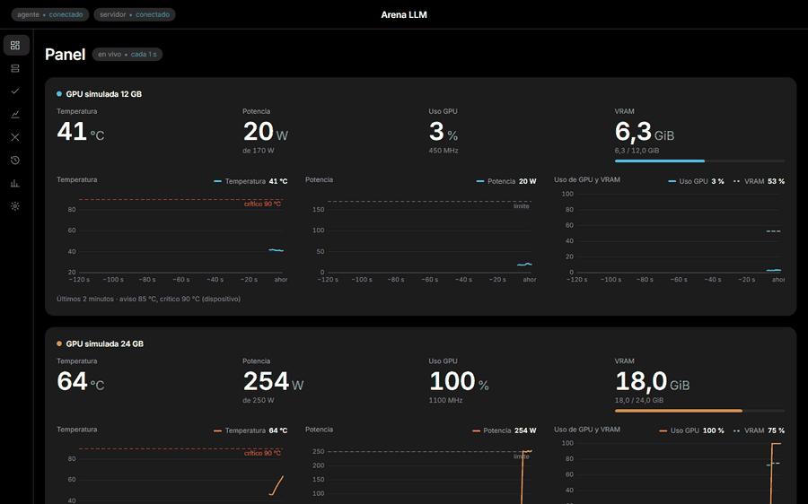

<sub>Acelerado ×3.</sub>

### Servidores

Dos pestañas: **En marcha** y **GGUF en disco**.

**En marcha.** Arena detecta los `llama-server` del equipo (proceso, `/props`, `/slots`, `/v1/models`): modelo, cuantización, contexto por slot, flags, build y en qué GPU corre, y los vuelve a mirar cada 5 s anotando cualquier cambio de configuración con su diff. Se puede **dar de alta un endpoint a mano** (otra máquina, un contenedor), **asignar GPU a mano**, ponerle alias y pulsar **▶ Probar** para ir a Calidad con ese servidor elegido.

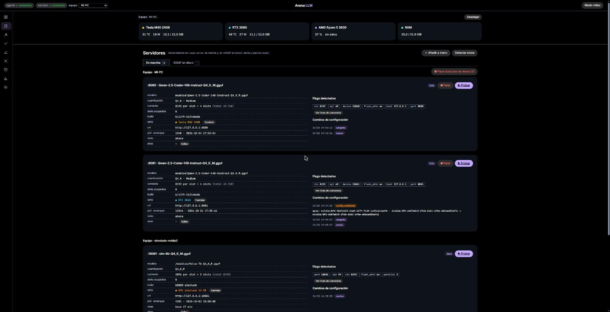

Aquí se ven dos `llama-server` lanzados desde Arena, uno por GPU (`-dev CUDA0` y `CUDA1`). Cada tarjeta muestra modelo, cuantización, contexto por slot, build, PID, GPU (con **Cambiar** para asignarla a mano) y el historial de cambios de configuración. **Parar todos los de Arena** solo apaga los que lanzó ella. (Al ser una captura de equipo real, las del perfil simulado también aparecen listadas en otro equipo más abajo.)

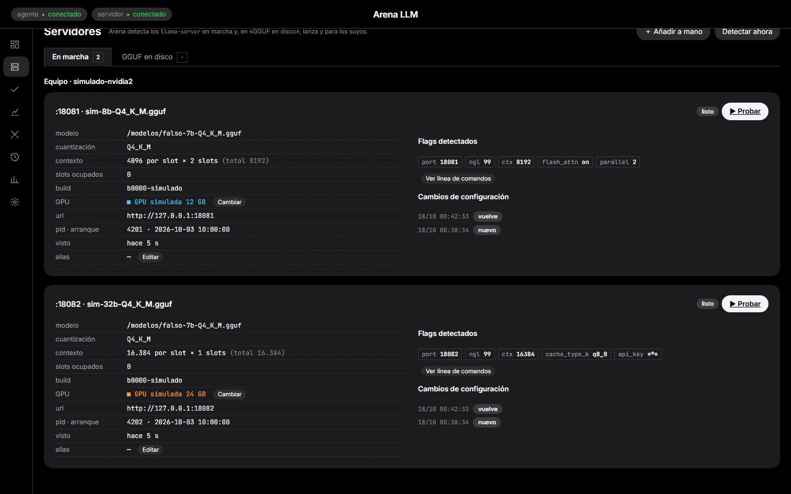

**GGUF en disco.** Lee la cabecera de cada GGUF de las carpetas permitidas y estima pesos por capa, caché KV, búfer de cómputo y reserva por GPU. Con el contexto, los slots y el tipo de caché KV que elijas, el veredicto se compara con la VRAM y la RAM **libres ahora**: cabe en una GPU, cabe repartido, necesita RAM (con el `-ngl` sugerido), solo CPU o no cabe. Todo lleva el sello `ESTIMADO`, y **Ver desglose** enseña cada partida.

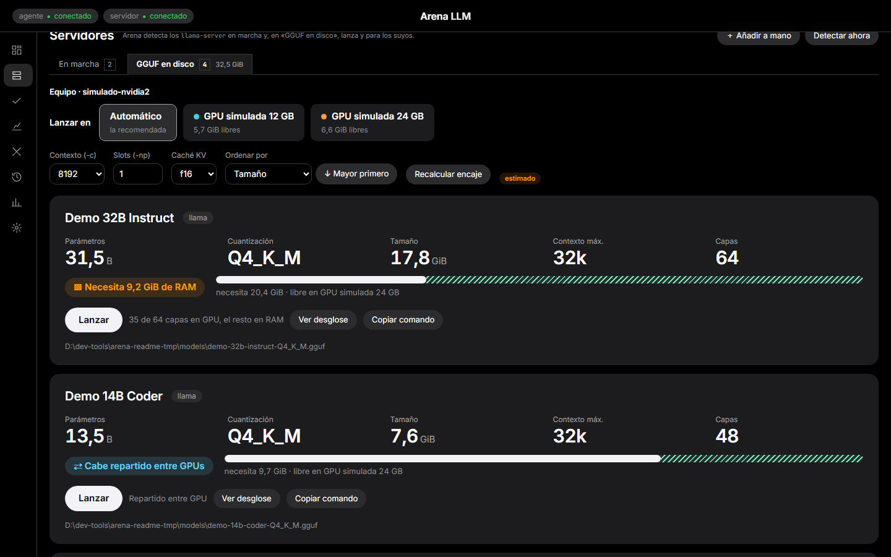

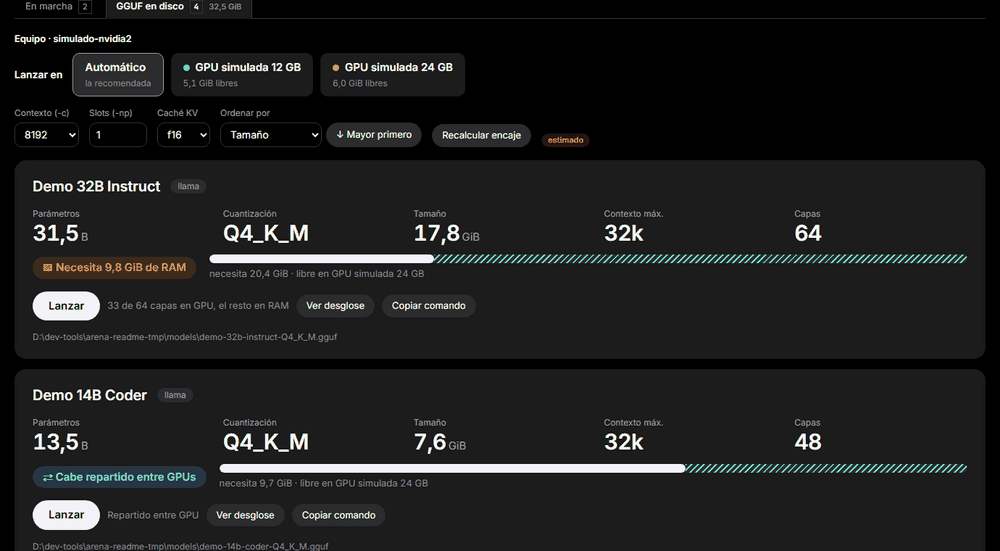

**Lanzar y parar `llama-server` desde la GUI.** Eliges la GPU destino arriba (**Lanzar en**: automático, que usa la recomendada, o una GPU concreta) y **Lanzar** arranca ese modelo con el contexto, los slots y la caché KV elegidos; mientras carga se ve su registro, y **Parar** lo detiene. Arena solo para los servidores que lanzó ella. El agente es quien ejecuta el binario, con una lista cerrada de flags validados, siempre en `127.0.0.1` y con modelos de las carpetas permitidas. Necesita `llama_server` (o un `llama-server` junto a `llama_bench`) en la configuración del agente.

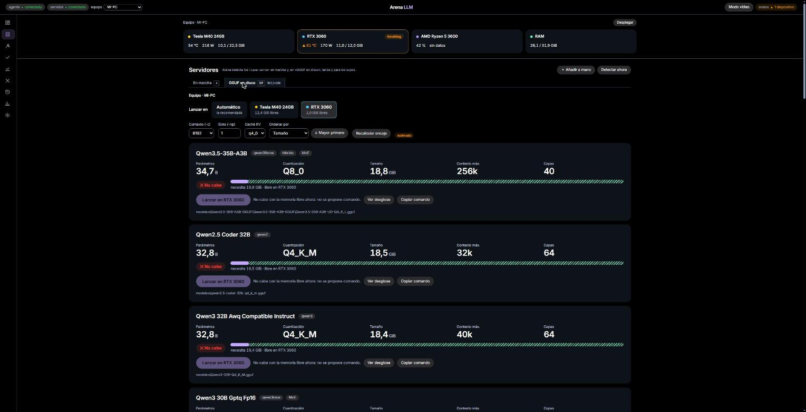

La captura muestra el selector **Lanzar en** (Automático, Tesla M40 o RTX 3060, con la memoria libre de cada una), los controles de contexto, slots y caché KV, y cada modelo con su veredicto y los botones **Lanzar en <GPU>**, **Ver desglose** y **Copiar comando** (el botón de lanzar queda desactivado si el modelo no cabe). Los servidores de la captura anterior se lanzaron así. No se grabó un GIF del lanzamiento para no tocar los servidores que estaban midiendo.

**Comando copiable.** **Copiar comando** compone la línea equivalente para ejecutarla a mano, en otro equipo o con otros flags: binario, `-m`, `-c`, `-ngl` sugerido, `-np`, tipo de caché KV, `-fa on` y un `--port` libre. Si cabe en varias GPU eliges en cuál (`-dev`); si va repartido añade `-ts`. Sale en la sintaxis de cmd y PowerShell en Windows, o de bash en Linux, con `CUDA_DEVICE_ORDER=PCI_BUS_ID` cuando fija dispositivo.

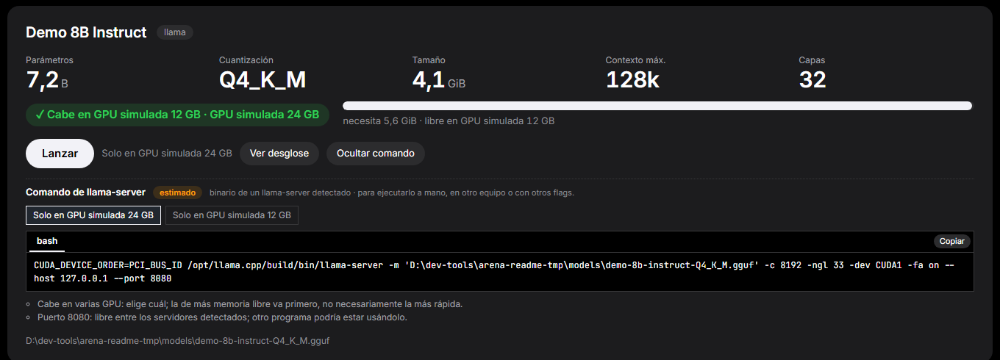

### Calidad

Pruebas sobre el servidor que elijas, con los parámetros comunes de generación (el perfil estándar fija temperatura 0, semilla 42 y caché de prompt desactivada; cambiarlos hace que el run deje de ser comparable con los del perfil).

- **Estrés GPU/VRAM**: peticiones largas en bucle durante el tiempo elegido, con fases de reposo, carga y enfriamiento. Aborta solo si una GPU llega a su umbral crítico.
- **Prompt libre**: uno o varios prompts con repeticiones, midiendo TTFT, t/s del cliente y del servidor y tokens.

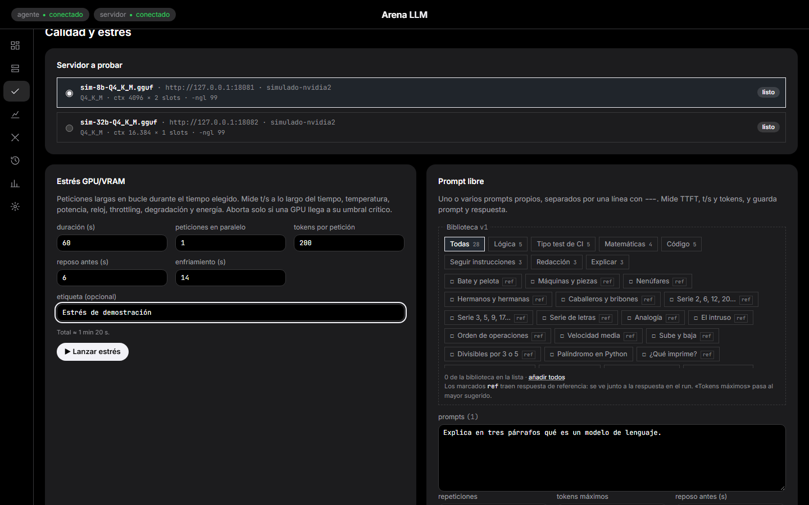

El estrés muestra en vivo t/s, temperatura, potencia de placa y reloj sincronizados:

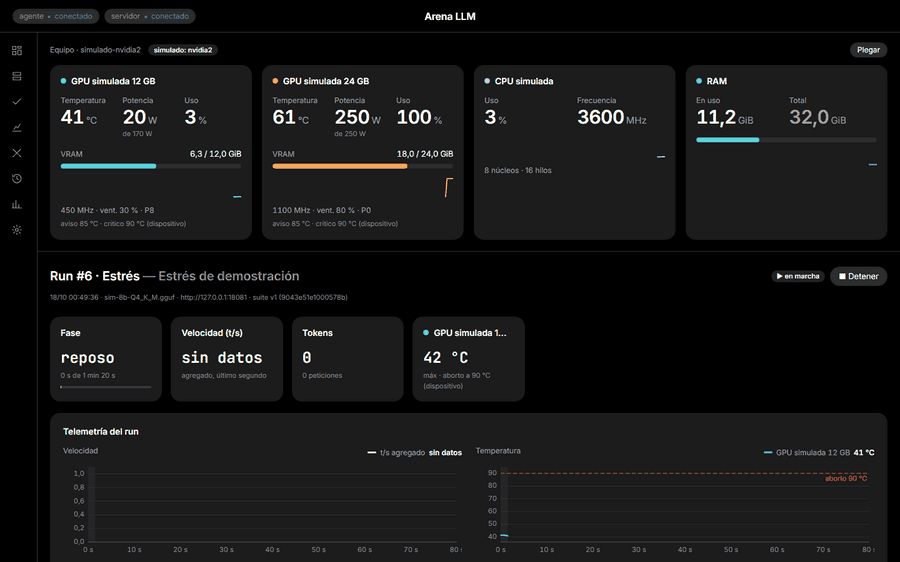

<sub>Acelerado ×3.</sub>

Al terminar queda el resultado completo: resumen (mediana de t/s, TTFT, degradación, energía y tokens por Wh, throttling), la **foto de configuración** guardada con el run (servidor, flags, modelo y parámetros) y cada petición.

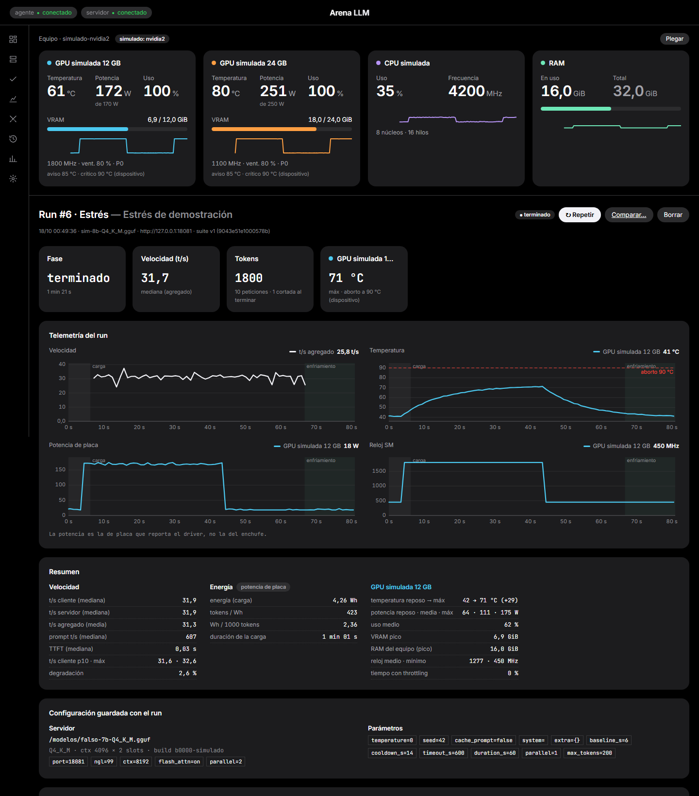

**Biblioteca de prompts.** 28 prompts en 7 categorías (lógica, tipo test de CI, matemáticas, código, seguir instrucciones, redacción y explicar), que se añaden con un clic, uno a uno o por categorías. Los que llevan `ref` traen **respuesta de referencia**, que se ve junto a la del modelo. La biblioteca es un fichero de datos ([`server/catalog/prompts.json`](server/catalog/prompts.json)); para añadir los tuyos sin tocar el repositorio, crea un `prompts.json` con la misma forma en la carpeta de datos (`data/` o `ARENA_DATA_DIR`). Un `id` repetido sustituye al de la base.

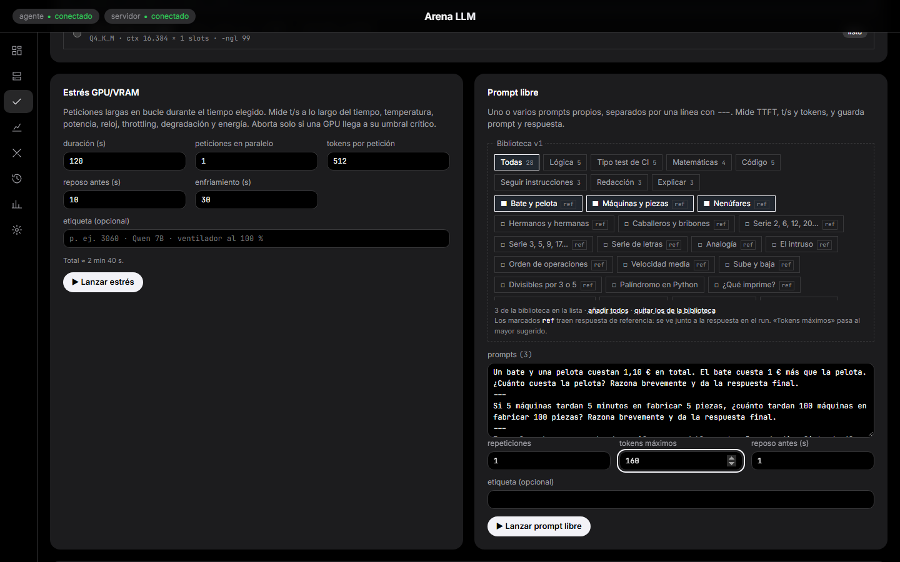

Además hay cuatro pruebas **con corrección automática** (F7): **QA** (12 preguntas con respuesta conocida), **Código** (10 problemas de Python ejecutados en un sandbox aislado, con pass@1), **Contexto** (aguja en un pajar por tamaño y profundidad) y **Concurrencia** (escalado de t/s con varias peticiones a la vez). El **Asistente** las encadena para muchos modelos × GPU: arranca cada modelo, lo mide, lo para y pasa al siguiente.

### Rendimiento (`llama-bench`)

Lanza `llama-bench` desde el agente, sin necesidad de un `llama-server` cargado (mejor que no lo haya, porque ocupa la tarjeta). Perfil estándar (pp512, tg128, 3 repeticiones) y cuatro pruebas:

- **Un dispositivo**: una GPU con todas las capas, o la CPU sin GPU.
- **Solo CPU/RAM**, con barrido de hilos.
- **Híbrido · curva de la RAM** (`-ngl`): cuánto se pierde por cada capa que pasa de la VRAM a la RAM.
- **Reparto entre GPU** (`-ts`): cómo repartir un modelo entre varias tarjetas (necesita 2 GPU o más).

Antes de lanzar, Arena avisa si un servidor ocupa la tarjeta o si el modelo no cabe (**Lanzar igualmente** lo permite).

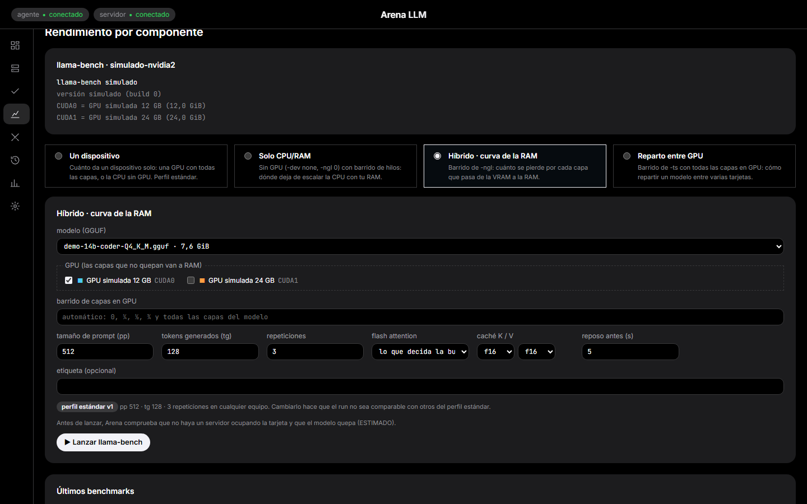

El run muestra la curva de t/s frente a las capas en GPU, una tabla con el % de capas en GPU y el ancho de banda efectivo (`ESTIMADO`), con la telemetría y el aborto térmico de siempre.

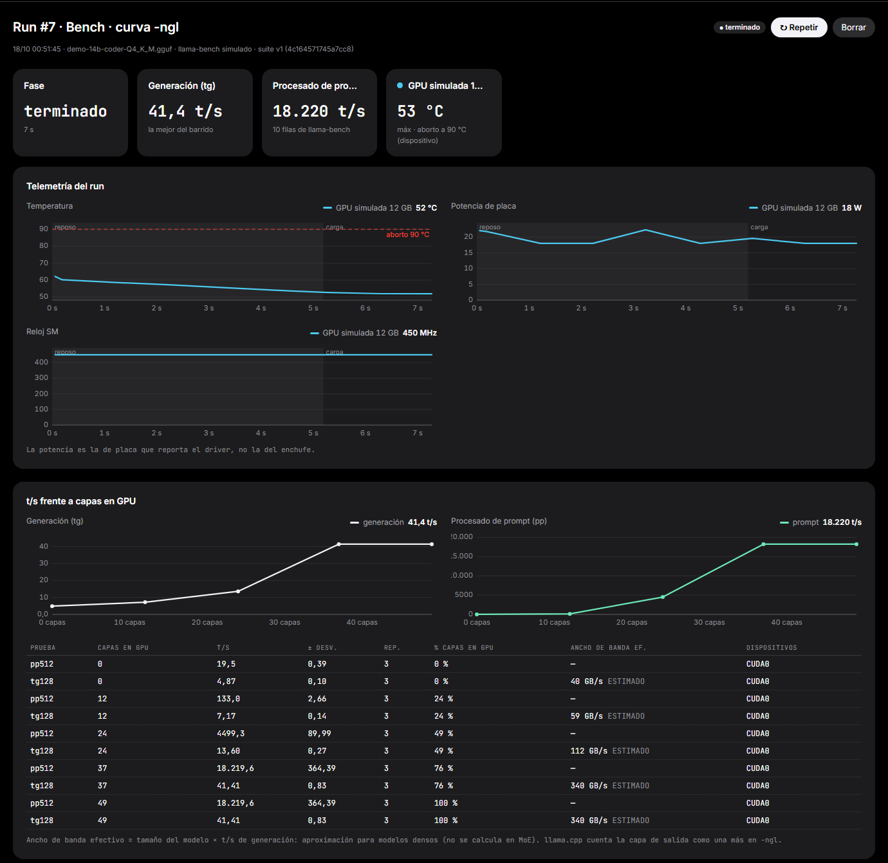

### Batalla

Los mismos prompts contra 2–6 servidores (lados), **en paralelo** (cada lado en su servidor, por ejemplo uno por GPU) o **uno detrás de otro** (vale con un solo servidor, por ejemplo para variar solo la temperatura).

- **Común a todos los lados**: prompts (con la biblioteca), semilla, temperatura y tokens máximos por defecto, repeticiones y fases.
- **Por lado**: servidor, etiqueta, temperatura, tokens máximos, `top_k/top_p/min_p`, penalización, caché de prompt, prompt de sistema y JSON `extra`, con «Copiar A →».

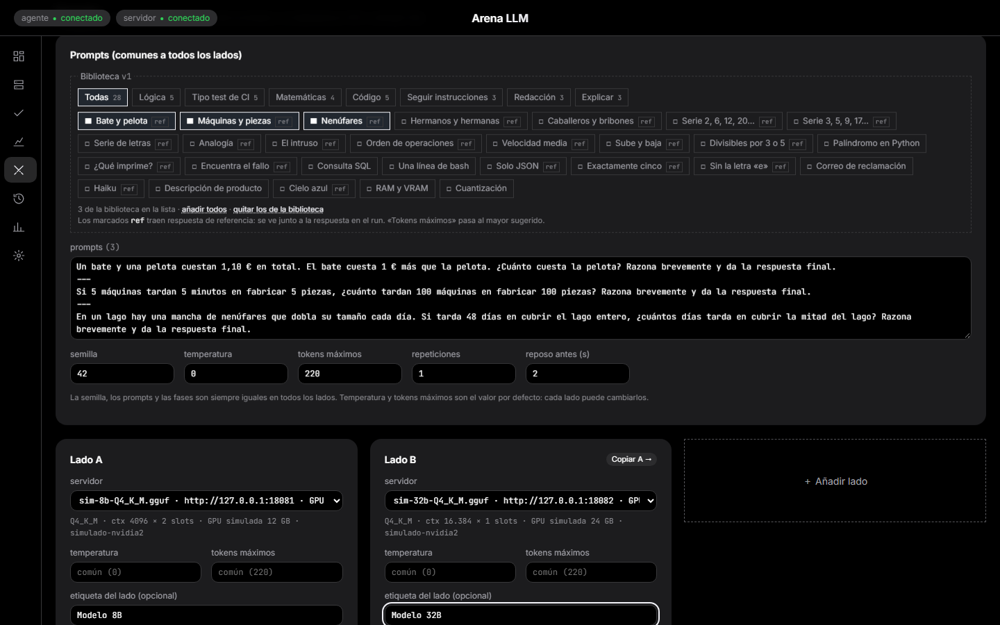

**En vivo**, la batalla ocupa la pantalla con una columna por lado: modelo, GPU que usa, **cronómetro**, **prompts contestados** (n / total), t/s, TTFT, tokens, temperatura máxima de su GPU, minigráfica y la respuesta en streaming. Si el modelo razona, el **razonamiento** sale en vivo («Pensando…») y se puede ocultar con «ver razonamiento». Se puede **Detener** en cualquier momento.

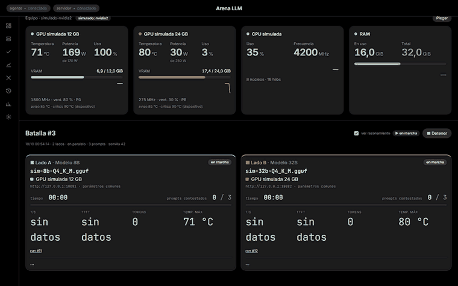

<sub>Acelerado ×1,3, de 40 s reales. Las respuestas son texto fijo del `llama-server` simulado, no responden al prompt.</sub>

Al terminar quedan las cifras de cada lado, el **marcador** (más rápido, responde antes, más frío, más eficiente, con su margen) y la tabla de métricas, más las respuestas de todos los lados prompt a prompt. Botones: **Ver en Comparar**, **Repetir** y **Borrar**. Antes de nada puedes cargar un **paquete** (más abajo), que fija prueba, opciones y pesos de la nota.

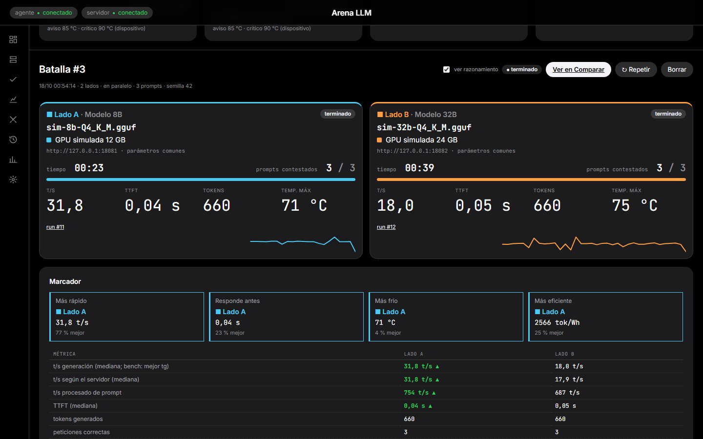

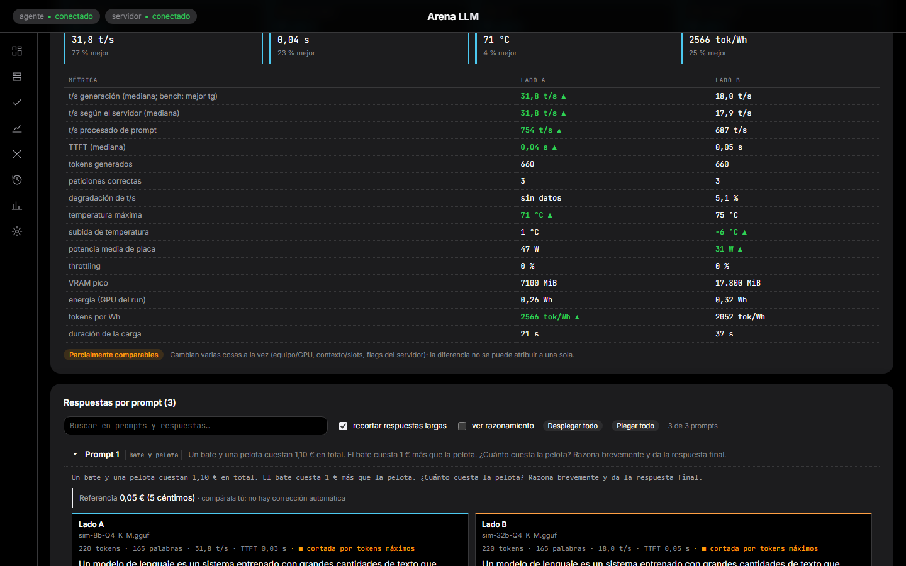

#### Paquetes de batalla y ranking

Arriba de la preparación hay **8 paquetes predeterminados**: un clic carga la prueba, sus opciones y los pesos de la nota, y después solo eliges los lados. Cada tarjeta dice qué mide, cuánto tarda y si **se corrige sola** o es **solo rendimiento**.

| Paquete | Prueba | Tiempo aprox. | Qué mide |
|---|---|---|---|
| Duelo rápido | QA (6 preguntas) | 3 min | Lógica y cálculo con respuesta conocida |
| Razonamiento | QA (12 preguntas) | 8 min | Razonamiento, cultura y precisión |
| Programador | Código (10 problemas) | 15 min | Python en sandbox, pass@1 |
| Programador (calentamiento) | Código (3 problemas) | 4 min | Descarta modelos pequeños sin esperar |
| Memoria larga | Contexto (aguja en un pajar) | 10 min | Hasta dónde lee bien y cuánto tarda |
| Velocidad pura | Prompt libre | 4 min | t/s, TTFT, eficiencia y estabilidad |
| Lectura: redacción y explicación | Prompt libre | 4 min | Prompts de escritura para leer lado a lado |
| Seguir instrucciones | Prompt libre | 3 min | JSON, listas y restricciones de letras |

Los paquetes son un fichero de datos ([`server/catalog/battles.json`](server/catalog/battles.json)); para añadir los tuyos, crea un `battles.json` con la misma forma en la carpeta de datos (`data/` o `ARENA_DATA_DIR`). Un `id` repetido sustituye al de la base. Cada batalla guarda su paquete (id, nombre y hash) y los pesos usados.

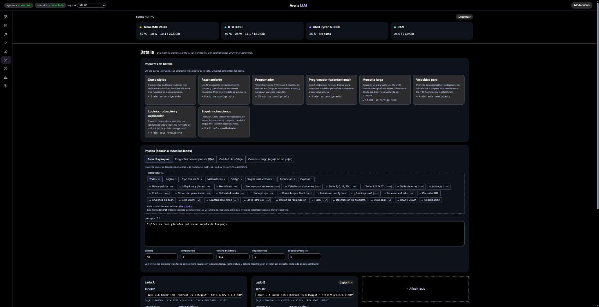

Al cargar un paquete aparece su **ranking acumulado**: modelo, equipo/GPU, aciertos (media), mejor t/s, TTFT y número de batallas. Solo cuentan las batallas con **el mismo hash del paquete** (mismas preguntas y opciones), así que los aciertos son comparables entre días; las de otra versión se cuentan aparte. Si el paquete no se corrige solo, manda la velocidad.

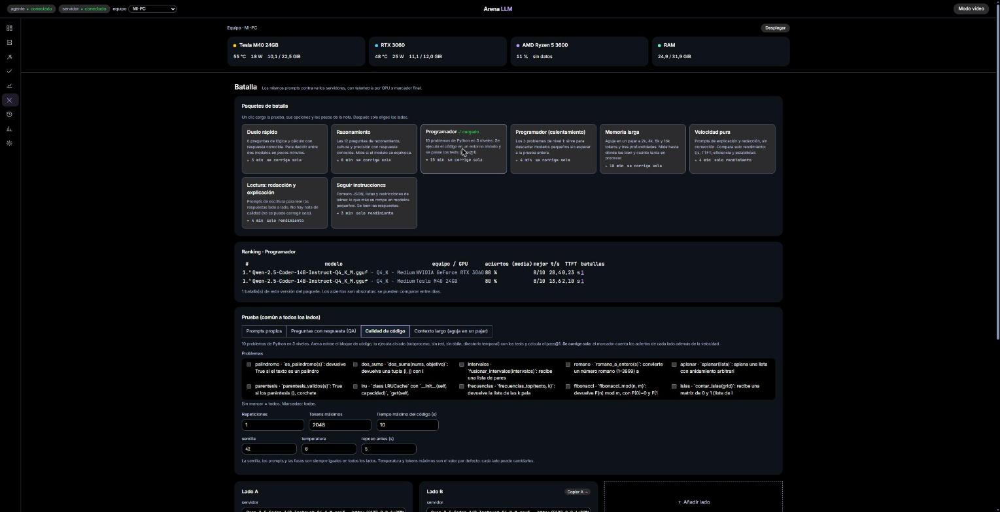

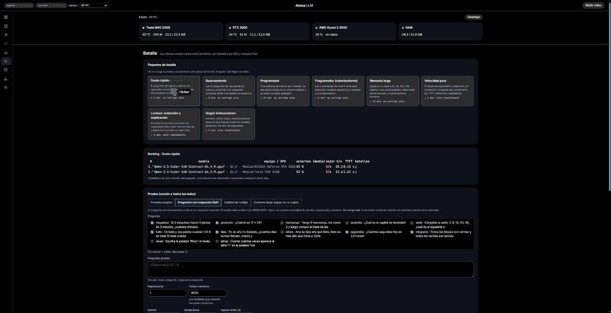

<sub>Solo se rellena el formulario; no se lanza nada hasta pulsar Iniciar.</sub>

#### Nota 0-100 y podio

Al terminar, cada lado recibe una **nota de 0 a 100** con cuatro dimensiones y un **podio**:

- **Calidad** (absoluta): aciertos de las pruebas que se corrigen solas. Vale entre batallas. Si no hay corrección (prompts libres), se omite.
- **Velocidad** (relativa): t/s y TTFT frente al mejor lado de la batalla (70 % / 30 %).
- **Eficiencia** (relativa): tokens por Wh, o t/s por GiB de VRAM si no hay potencia.
- **Estabilidad** (absoluta): 100 menos el tiempo en throttling y la degradación de t/s. Solo cuenta el límite térmico y el frenado de hardware, no el límite de potencia por software.

Los pesos los fija el paquete (por ejemplo, Programador 70/10/10/10; Velocidad pura 0/55/25/20) o, sin paquete, 50/25/15/10. Una dimensión sin datos no puntúa 0: se omite y su peso se reparte. Un run en error no recibe nota ni puede ganar. La nota global solo es comparable dentro de su batalla; la calidad, en cualquier sitio.

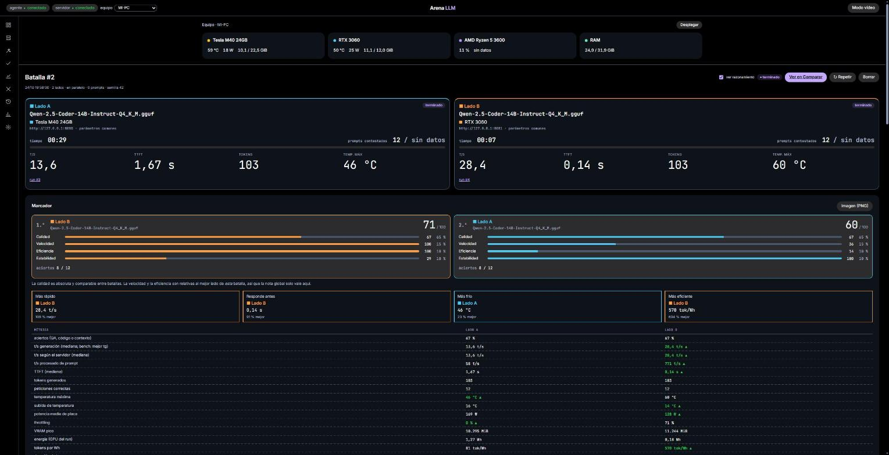

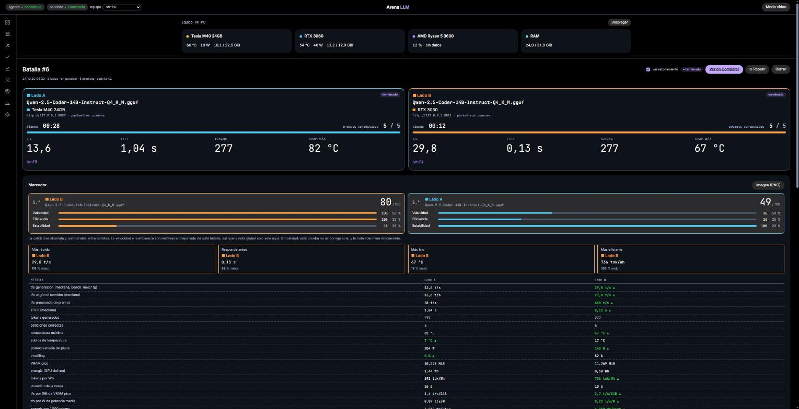

### Comparar

Elige runs en el Historial (bandeja «Comparar (N)»), desde una batalla o en la propia página (hasta 12; con uno solo sirve para leer sus respuestas). Arriba, la **insignia de comparabilidad** con sus motivos:

- *No comparables*: es otra prueba u otra versión de la prueba.
- *Parcialmente*: prompts distintos, algún run incompleto o cambian varias cosas a la vez (por ejemplo, modelo y GPU).
- *Comparables*: cambia como mucho un factor, justo el que se compara.

Cuatro pestañas:

- **Resumen**: la **Puntuación** 0-100 de cada run (calidad, velocidad, eficiencia y estabilidad), los veredictos con su margen y los datos principales con el mejor valor marcado (▲).

  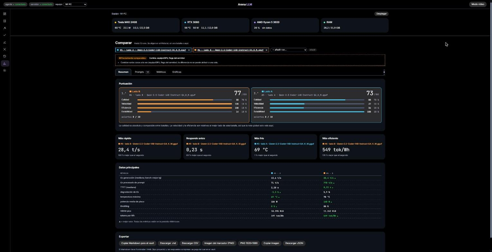

  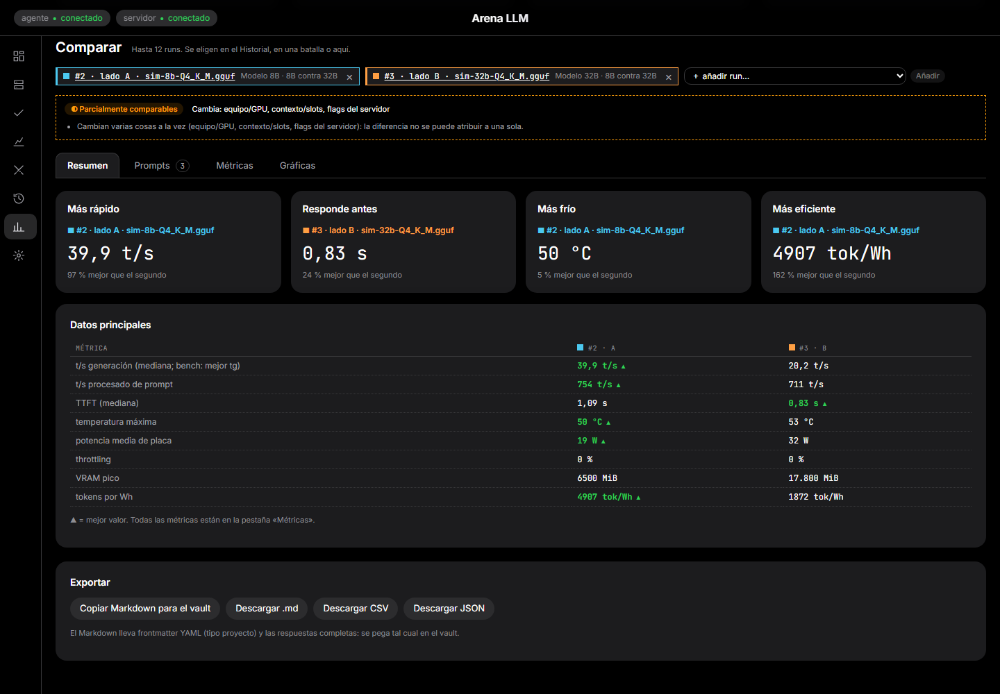

- **Prompts**: las respuestas de todos los runs, prompt a prompt, una columna por run. Cada respuesta lleva la referencia de la biblioteca (si la hay), tokens, palabras, t/s y TTFT, el aviso «cortada por tokens máximos», un buscador, razonamiento opcional y desplegar/plegar todo.

  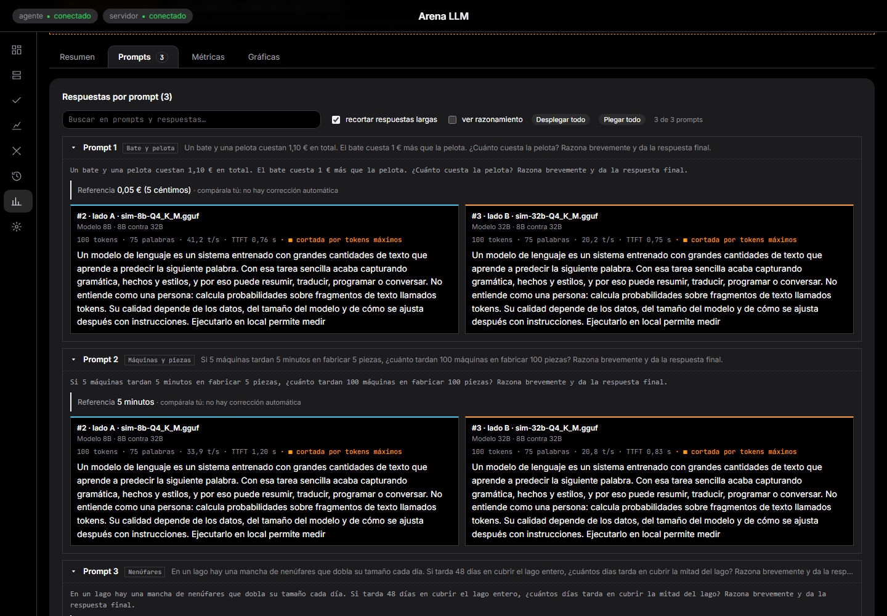

- **Métricas**: todas las métricas, con el mejor valor marcado, y el **diff de configuración** (≠ cuando cambia entre runs). La temperatura, la potencia y la energía son solo las de la GPU de cada run.

  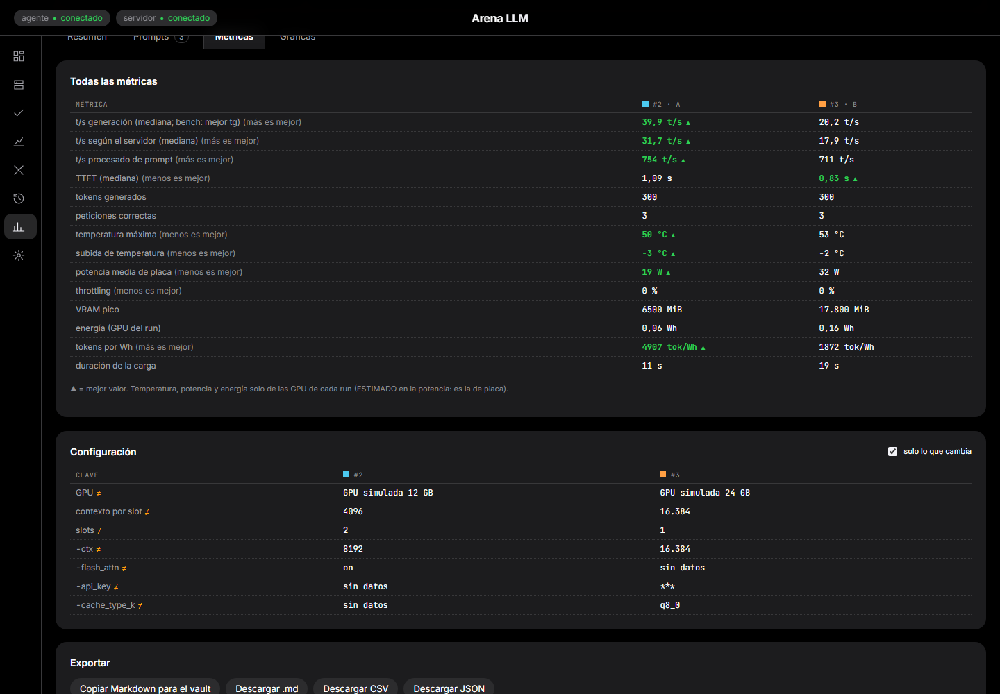

- **Gráficas**: el **visor de gráficas** (desde el inicio de la carga). Eliges magnitud (velocidad, temperatura, potencia de placa), disposición (runs superpuestos o una gráfica por run), qué runs ver y el aspecto (eje Y desde 0, relleno bajo la línea, marcar puntos y alto).

  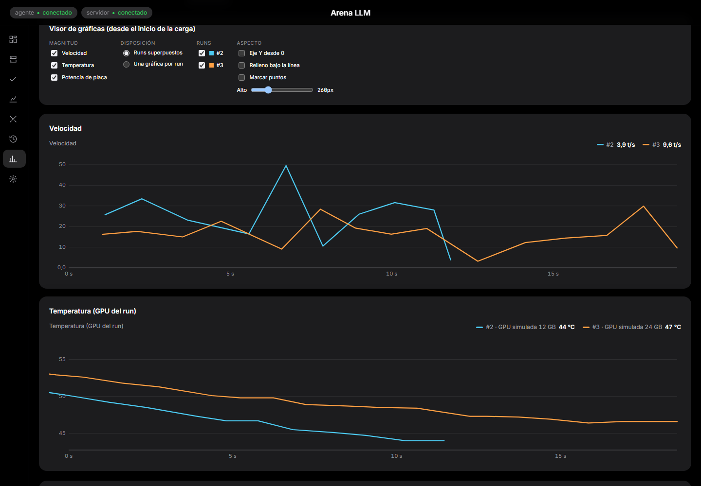

  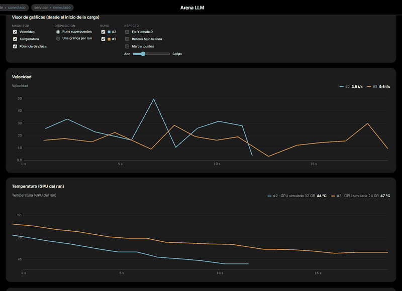

### Historial

Todos los runs guardados, con su servidor, modelo, suite (versión y hash) y métricas principales (t/s, tokens, temperatura máxima, energía, duración). Hay buscador (prueba, nombre, etiqueta, nota, modelo, estado) y filtros por equipo, dispositivo, prueba, estado y etiqueta. Cada run admite **nombre, etiquetas y notas** editables. Se marcan con casillas para compararlos («Ver respuestas» con uno solo) o para **exportar un paquete de resultados**; **Importar paquete…** trae los de otra instalación (con la etiqueta `importado`). Los lados de una batalla enlazan a ella.

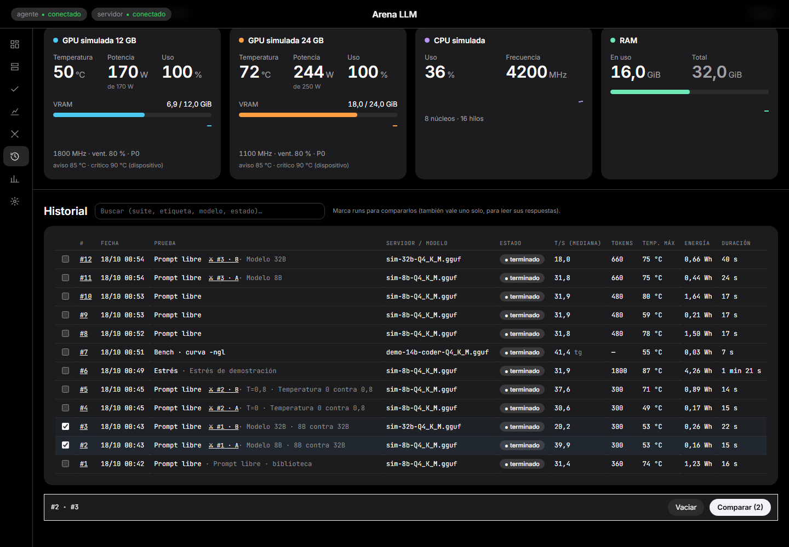

### Ajustes

Cuatro apartados:

- **Apariencia**: color de acento, contraste y tamaño de la interfaz.
- **Equipos (agentes)**: añadir o quitar equipos con su URL y token (obligatorio fuera de localhost).
- **Umbrales térmicos** por dispositivo, de aviso y de aborto, o «Automático».
- **Datos**: runs guardados, servidores conocidos y dónde está la base de datos. Para llevar resultados a otra instalación, usa el paquete de resultados del Historial.

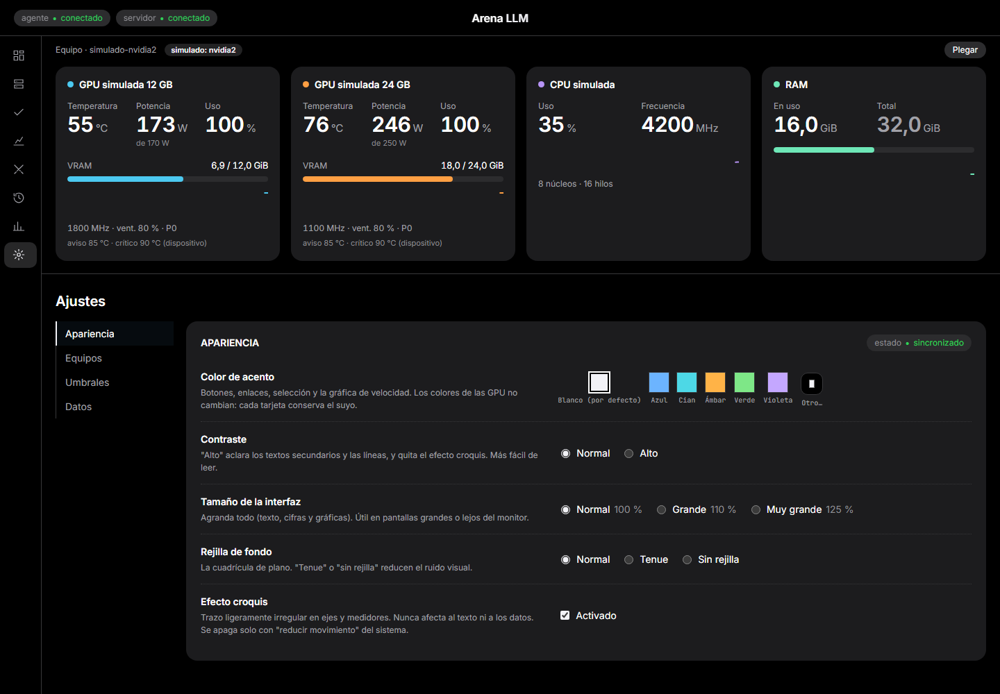

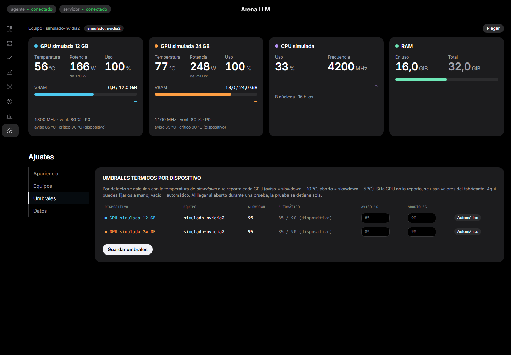

### Exportación

En Comparar, el apartado **Exportar** (debajo de las pestañas): **Copiar Markdown para el vault** (frontmatter YAML de tipo proyecto, etiquetas, notas, tablas y respuestas completas), **Descargar .md**, **CSV** (con `;`), **JSON** y la **imagen PNG del marcador** (1280×720 o 1920×1080; también en la Batalla). La casilla **normalizar** añade t/s por GiB de VRAM, por W y Wh por 1000 tokens (`ESTIMADO` cuando usan potencia de placa).

**Paquete de resultados** (`arena-pack`): en el Historial, **Exportar paquete** guarda los runs marcados en un JSON con la ficha de equipo, el servidor, el modelo, la versión de prueba, los ítems y las series, sin rutas personales, URLs ni tokens; **Importar paquete…** los trae a otra instalación sin duplicar lo ya existente.

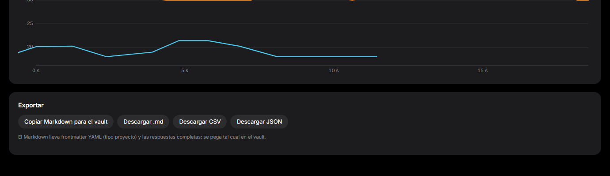

## Novedades recientes de la interfaz

- **Modo vídeo** para grabar: botón en la barra superior, tecla **V** o `?video=1`; oculta menús y barras, agranda todo (zoom 1,6×), sube el contraste y quita las animaciones. **Esc** para salir.
- **Recomendaciones por hardware** en Servidores → GGUF en disco (★ Mejor para tu hardware), que con destino Automático prefieren la GPU de mayor ancho de banda medido en Rendimiento.

- **Menú lateral plegado** que se abre al pasar el cursor (o al enfocarlo con el teclado). Las opciones cercanas a la que tocas se desplazan en **ola** según su distancia, y al abrirse enseña la VRAM y la RAM de cada dispositivo. «Desplegar» lo deja fijo.

  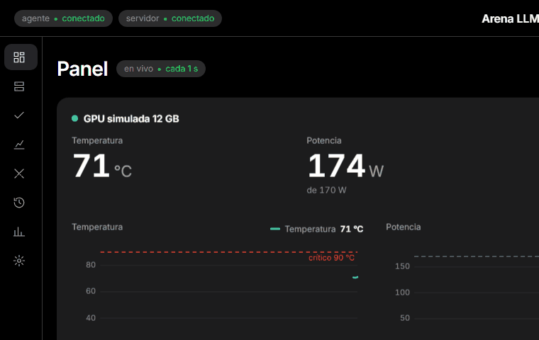

  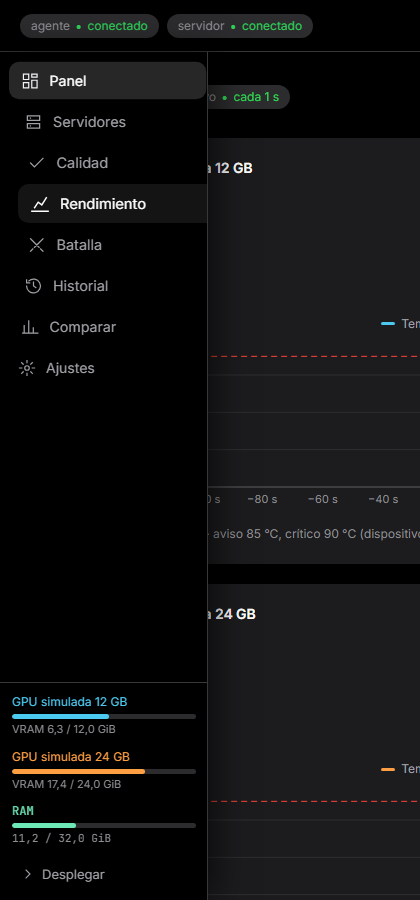

- **Efectos hover** en botones y tarjetas.

  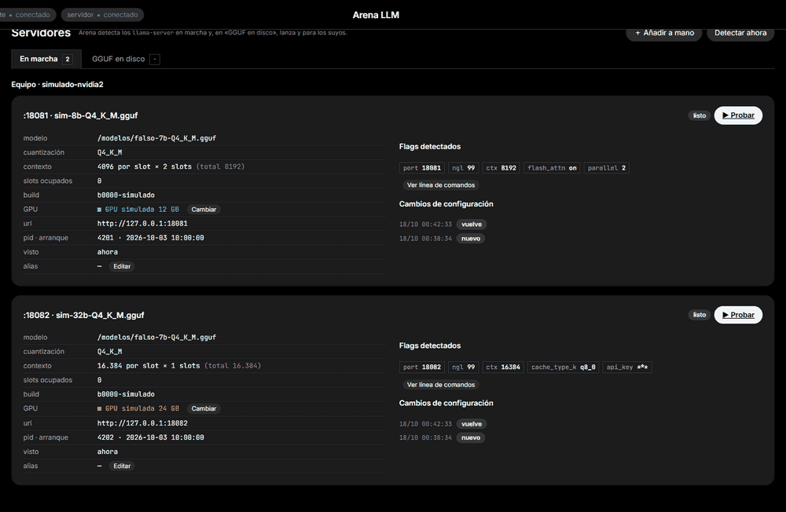

- **Los servidores detectados que se paran desaparecen de la lista** (sus runs conservan su propia foto de configuración). Los dados de alta a mano se quedan hasta que se quitan.

  > Sin captura: el agente simulado mantiene siempre su lista de procesos, así que no hay forma de reproducirlo en el modo simulado.

- **Batalla a pantalla completa** con modelo, GPU, cronómetro, prompts contestados y razonamiento en vivo, y **Comparar en pestañas** con visor de gráficas (ver arriba).
- **Lanzar y parar `llama-server`** desde Servidores → GGUF en disco, con GPU destino y orden de modelos.

## Instalación y arranque

### 1. Instalar (una vez)

```bat
scripts\setup.bat          :: crea .venv (Python 3.12 por defecto; scripts\setup.bat 3.11 para otra versión)
scripts\build-web.bat      :: compila la web en web\dist (repetir tras cambios en web\)
```

En Linux, los mismos scripts terminan en `.sh`. Instala Python, Node y los entornos en un disco con espacio (en este PC, `D:`).

### 2. Configurar el agente (una vez por equipo)

Crea `%APPDATA%\ArenaLLM\agent.json` en Windows, o `~/.config/arena-llm/agent.json` en Linux:

```json
{
  "model_dirs": ["D:/modelos"],
  "llama_bench": "D:/llama.cpp/llama-bench.exe",
  "llama_server": "D:/llama.cpp/llama-server.exe"
}
```

- `model_dirs`: carpetas cuyos GGUF puede leer el agente (calculadora, lanzador y `llama-bench`). Sin esta clave, el agente funciona pero no lee GGUF.
- `llama_bench`: para la página Rendimiento.
- `llama_server`: para lanzar desde la GUI y para el comando propuesto. Si falta, se usa el `llama-server` que haya junto a `llama-bench`.

La configuración se busca, por este orden, en `--config <fichero>`, en la variable `ARENA_AGENT_CONFIG` y en la ruta de arriba.

### 3. Uso normal

Lo más cómodo en Windows: **`scriptsrena.bat`** (doble clic). Arranca el agente y el servidor si no están ya en marcha y abre la GUI en `http://127.0.0.1:8090`. Si prefieres controlarlo:

```bat
scripts\start-agent.bat    :: agente en 127.0.0.1:9100 (déjalo abierto)
scripts\start-server.bat --agent http://127.0.0.1:9100    :: servidor en http://127.0.0.1:8090
```

Abre `http://127.0.0.1:8090`. Después: **Servidores → GGUF en disco** para lanzar un modelo (o copiar su comando), **Calidad**, **Rendimiento** o **Batalla** para probarlo, y **Historial / Comparar** para revisar y comparar. `scripts\stop.bat` para todo lo de Arena, pero no toca los `llama-server` que hayas lanzado tú.

### Demo sin GPU

```bat
scripts\demo.bat D:\modelos    :: agente real + agente simulado (2 GPU, 2 llama-server simulados) + servidor, y abre el navegador
```

### Por piezas y perfiles simulados

```bash
# Agente (cada equipo con GPU). Solo escucha en localhost salvo que haya token.
python -m agent --port 9100 --models-dir D:/modelos --llama-bench D:/llama.cpp/llama-bench.exe
python -m agent --simulate nvidia2        # perfiles: nvidia2 | cpu-only | partial
ARENA_AGENT_TOKEN=... python -m agent --host 0.0.0.0   # fuera de localhost exige token

# Servidor (puerto 8090; el 8080 lo usa llama-server)
python -m server --agent http://127.0.0.1:9100 [--port 8090] [--data-dir <carpeta>]

# llama-server simulado (sin GPU), para desarrollar o probar
python -m server.fakes.fake_llama --port 18081 --tps 40

# Web en desarrollo con recarga en caliente (necesita el servidor en marcha)
npm run dev --prefix web

# Tests
pytest && npm test --prefix web
```

Los perfiles simulados son `nvidia2` (dos GPU NVIDIA con servidores simulados), `cpu-only` (sin GPU) y `partial` (una GPU que no expone ventilador, potencia ni throttling, para probar los "sin datos"). En Windows, `python` es el de `.venv\Scripts\python.exe` (los scripts `.bat` ya lo usan).

## Principios

- **Independiente del hardware.** Nada cableado: ni nombres de GPU, ni puertos, ni rutas, ni VRAM, ni umbrales. Todo se autodetecta o se configura. Los proveedores de telemetría son enchufables (v1: NVIDIA y CPU/RAM; un equipo solo con CPU también funciona).
- **Reproducible y comparable.** Cada prueba tiene versión y hash. El perfil estándar fija semilla, temperatura 0 y `cache_prompt` desactivado, y cada run guarda su foto de configuración completa y la insignia Comparables / Parcialmente / No comparables al compararlos.
- **Detecta siempre, lanza solo lo pedido.** Arena detecta cualquier `llama-server` lo haya lanzado quien lo haya lanzado. Desde la GUI solo lanza y para los que ella arrancó, y el agente lanza `llama-bench`.
- **No inventa datos.** Lo que no se puede medir sale como "sin datos", nunca como 0. Las estimaciones (encaje, comando propuesto, ancho de banda, potencia de placa…) llevan el sello `ESTIMADO`.
- **Seguridad.** El agente escucha en `127.0.0.1` y, fuera de localhost, exige token. No es una shell remota: solo ejecuta `llama-bench` y `llama-server` de su configuración, con flags validados, modelos dentro de `model_dirs` y sin aceptar peticiones con cabecera `Origin`. No se suben al repositorio la base de datos, los resultados reales, los modelos, las rutas personales ni los tokens.

## Componentes

| Carpeta | Qué es | Requisitos |
|---|---|---|
| `agent/` | Agente por equipo: telemetría (GPU, CPU, RAM), detección y lanzador de `llama-server`, cabeceras GGUF y `llama-bench` | Python 3.11+, **solo biblioteca estándar** (+ `nvidia-smi` si hay GPU NVIDIA) |
| `server/` | API, sondeo de agentes, eventos en vivo (SSE), runner de pruebas, calculadora y base de datos SQLite | Python 3.11+, FastAPI, uvicorn, httpx |
| `web/` | Interfaz en Vue 3 + Vite + TypeScript, con gráficas propias en SVG | Node 20+ (solo para compilarla) |

## Estado por fases

| Fase | Qué | Estado |
|---|---|---|
| F1 | Esqueleto y agente (telemetría, detección, perfiles simulados) | ✅ |
| F2 | GUI base y plano del equipo | ✅ |
| F3 | Servidores, modelos y detección (calculadora de encaje, comando de arranque, lanzar y parar, alta manual) | Casi: falta un criterio con un servidor real |
| F4 | Runner núcleo (prompt libre y biblioteca de prompts) | ✅ |
| F5 | Telemetría sincronizada, resumen y estrés | ✅ salvo la prueba real de 5 min |
| F6 | Rendimiento por componente (`llama-bench`) | ✅ (reparto `-ts` probado solo en simulado) |
| — | Recomendaciones de modelos según el hardware | ✅ (falta el catálogo editable) |
| F7 | Pruebas de calidad (razonamiento, código aislado, contexto largo, concurrencia) y Asistente de barridos | ✅ (contexto y concurrencia sin probar con GPU reales) |
| F8 | Batalla: el mismo prompt en dos o más lados, con paquetes predeterminados, nota 0-100 y ranking por paquete | ✅ (probada con dos GPU reales: M40 y RTX 3060) |
| F9 | Historial, comparación (insignia de comparabilidad) y exportación | ✅ |
| F10 | Modo vídeo, accesibilidad y documentación de uso | ✅ (accesibilidad sin probar con lector de pantalla) |
| F11–F12 | Despliegue en Linux y backlog | Pendiente |

## Datos

La base de datos vive en `data/` o en la ruta de `ARENA_DATA_DIR`. `data/` está excluida de git y de Syncthing, y los datos nunca se suben al repositorio.

## Documentación

- [`docs/HOJA-DE-RUTA.md`](docs/HOJA-DE-RUTA.md): decisiones y fases.
- [`docs/PLAN-CONSTRUCCION.md`](docs/PLAN-CONSTRUCCION.md): módulos, contrato entre agente y servidor, e hitos.
- [`docs/USO.md`](docs/USO.md): guía de uso por flujos y pantallas.
- [`docs/EXTENDER.md`](docs/EXTENDER.md): cómo añadir un servidor, un equipo, una GPU de otro fabricante o una prueba.
- [`docs/GUI-DISENO.md`](docs/GUI-DISENO.md): interfaz.
- [`docs/VIABILIDAD.md`](docs/VIABILIDAD.md): riesgos, métricas y datasets de pruebas.
- [`ESTADO.md`](ESTADO.md): estado actual y cierre de cada sesión.
